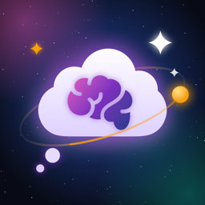

<div align="center">



# Mull — AI Brain Dump

**Capture every thought. Let AI make sense of it.**

[](https://swift.org)
[](https://developer.apple.com/ios/)
[](https://developer.apple.com/xcode/swiftui/)
[](https://developer.apple.com/xcode/swiftdata/)
[](LICENSE)

*An iPhone app to dump raw thoughts — by voice or text — and have AI categorize them, build your task list, and summarize your day.*

</div>

---

## ✨ What It Does

Ever had 50 thoughts racing through your head and no way to make sense of them? **Mull** lets you:

1. **Brain dump** freely — speak or type whatever's on your mind, or press the Action Button to start recording instantly
2. **AI categorizes** your thoughts automatically into meaningful groups
3. **AI plans your tasks** in an Eisenhower matrix (Do First, Schedule, Delegate, Eliminate)
4. **Get a daily summary** with a generated image — and browse past days in History

By default everything runs **on your iPhone with Apple Intelligence** — free, private, offline.

---

## 📱 Features

| Feature | Description |
|---|---|
| 🎙️ **Voice Input** | Tap to speak — auto-stops after a short silence; transcribed on-device |
| ⚡ **Action Button & Siri** | "Record a Thought" shortcut opens straight into recording |
| 🤖 **AI Categorization** | Groups related thoughts into named categories |
| ✅ **Mission Control** | AI-generated tasks in an Eisenhower matrix with progress ring |
| 📋 **Daily Summary + Image** | AI digest of your day with an illustration (Image Playground or OpenAI) |
| 🕰️ **History** | Past days stay summarized and illustrated automatically |
| 🌌 **Space Theme** | Animated star field, nebula colors, custom glowing dialogs |
| 🔒 **Private by Default** | Data stored locally with SwiftData; API keys in the Keychain |

---

## 🤖 AI Providers

| Provider | Runs | Images | Needs |
|---|---|---|---|
| 🍎 **Apple Intelligence** (default) | On-device | Image Playground | iPhone with Apple Intelligence |
| 🟢 **OpenAI** | Cloud | OpenAI images | Your own API key |
| 🟣 **Anthropic Claude** | Cloud | — | Your own API key |

Cloud providers are opt-in: the app shows how to get a key and asks for consent before any thoughts are sent.

---

## 🏗️ Architecture

```
summary/
├── Models.swift                   # SwiftData models (Thought, ThoughtCategory, DailySummary, TodoItem)
├── ThoughtsViewModel.swift        # Central state & business logic
├── AppSettings.swift              # Provider choice, consent, Keychain-backed API keys
├── KeychainStore.swift            # Minimal Keychain wrapper
├── VoiceCaptureIntent.swift       # App Intent for Action Button / Siri
│
├── AI Services
│   ├── AIService.swift            # Protocol + shared JSON parser
│   ├── AppleIntelligenceService.swift  # FoundationModels + Image Playground
│   ├── ClaudeService.swift
│   └── OpenAIService.swift
│
├── Views
│   ├── ContentView.swift          # Tab container
│   ├── DumpView.swift             # Brain dump screen
│   ├── CategoriesView.swift / CategoryDetailView.swift
│   ├── DailySummaryView.swift / DailyHistoryView.swift
│   ├── TasksView.swift / TodoEditSheet.swift   # Mission Control
│   ├── SettingsView.swift / APIKeyGuideSheet.swift
│   └── SpaceTheme.swift / SpaceDialog.swift / ImageZoomViewer.swift
│
└── SpeechRecognizer.swift         # AVFoundation + Speech, silence detection
```

**Stack:** SwiftUI · SwiftData · FoundationModels · ImagePlayground · App Intents · Speech · AVFoundation

---

## 🚀 Getting Started

### Prerequisites
- Xcode 26+
- iPhone running iOS 26+ (Apple Intelligence features need a supported iPhone)
- (Optional) OpenAI or Anthropic API key

### Setup

```bash
git clone https://github.com/Bhargavacharanreddy/thoughts-summarization-ios.git
cd thoughts-summarization-ios
open summary.xcodeproj
```

Select your own development team under **Signing & Capabilities**, change the bundle identifier if needed, and hit **Run** — no package dependencies.

---

## 🔒 Privacy

| Data | Where it goes |
|---|---|
| Your thoughts, summaries, tasks | Stored locally on your iPhone (SwiftData) |
| Voice audio | Transcribed on-device when supported; never stored |
| AI requests | On-device with Apple Intelligence, or only to the cloud provider you choose and consent to |
| API keys | Stored in the iOS Keychain on your device |

Full policy: [Privacy Policy](https://bhargavacharanreddy.github.io/thoughts-summarization-ios/privacy.html)

---

## 📄 License

[MIT](LICENSE) © 2026 Bhargavacharanreddy
